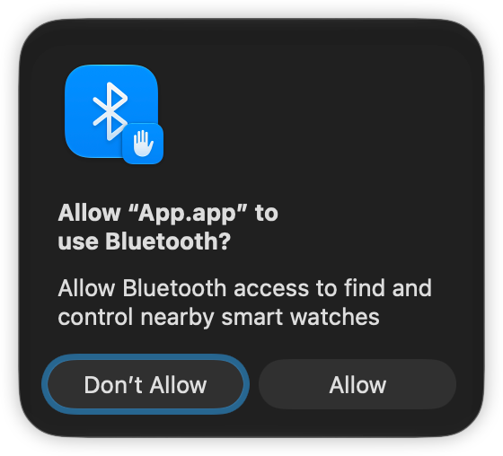
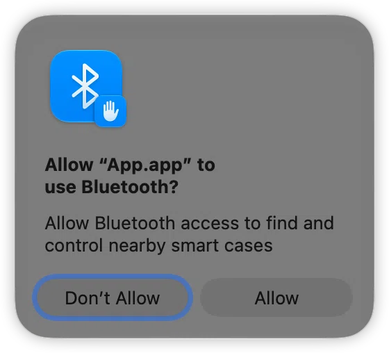

# Bug 4: Bluetooth Permission Popup Wrongly Says "smart watches" — Troubleshooting Record

> 4. When `app` starts the first time, the Bluetooth permission popup says "Allow Bluetooth access to find and control nearby smart watches". This is wrong, the popup should say "Allow Bluetooth access to find and control nearby smart cases".

## 1. Pinned Version and Context

- Baseline branch / commit: main @ ad266971 (Initial commit; the fix branch was cut from that same commit)
- Uncommitted changes and how they were saved: the fix is committed as `2ad9eb9` (`app/App.xcodeproj/project.pbxproj`, the two UsageDescription entries in Debug / Release: watches→cases, that single file only); this record plus the three screenshots under `bug-analysis-images/` go in a separate `docs:` commit
- Fix branch: `fix/04-bluetooth-usage-description`
- Environment: Mac (MacBookAir10,1 / Apple M1, macOS 27.0.1); iPhone N/A (this bug only involves the Mac side); Xcode 27.1 (27A9275)
- Bluetooth permission / initial button data: the Bluetooth permission is the subject of this bug — macOS TCC caches the authorization decision by bundle id (com.bragi.App), and the popup only appears when no cached record exists; initial button data N/A

> Do not use reset/clean to pin the version; do not upgrade dependencies or the OS while troubleshooting.

## 2. Symptom and Reproduction

- Expected / basis: README Bug 4 — the popup should read "Allow Bluetooth access to find and control nearby smart cases"; actual: it reads "…nearby smart watches"
- Last known-good time / version / configuration: none (on the baseline the very first visible popup is already wrong, not a regression)
- Initial classification: suspected defect (permission description does not match the product)

| Step | Action | Expected | Actual |
| --- | --- | --- | --- |
| 1 | With no com.bragi.App record in the system's Bluetooth authorization list (first run, or first remove the App under System Settings > Privacy & Security > Bluetooth), build and run the App scheme (Mac-side app) | The popup's description reads smart cases | The popup reads smart watches (image below, 2026-10-30) |

- Reproduction count / minimal repro: reproduced on 2026-10-30. Minimal repro = run App while TCC holds no com.bragi.App record; the full "fix → verify" loop was actually run two or three times (with some back-and-forth: when "remove the authorization" was skipped, the popup did not appear at all — see 3.3)
- Logs if needed: not collected (a pure wording issue, no logs required)

## 3. Layered Trace (easy → hard, stop once the fault is located)

Fill four columns per layer; conclusions are: anomaly found / no anomaly seen / insufficient evidence / N/A.
Approach: follow "the value the upper layer sent → the value the lower layer received" and find the earliest boundary where they diverge.

### 3.1 App code layer (both Mac `app` and iPhone `smartcase`)

| What to check / where | Expected | Actual | Conclusion |
| --- | --- | --- | --- |
| Repo-wide search for `smart watches` (`grep -rn "smart watches" --exclude-dir=.build --exclude-dir=.git .`) | Locate the single source of truth for the wording | Two hits in `app/App.xcodeproj/project.pbxproj` (`INFOPLIST_KEY_NSBluetoothAlwaysUsageDescription` in Debug / Release) plus the README's own quote of the symptom; neither the Swift sources nor `app/App/Info.plist` (an empty `<dict/>`) contains the string | Anomaly found |

### 3.2 SDK layer (SmartCaseKit: encoding, decoding, state)

N/A (SmartCaseKit does not contain this wording and was not changed).

(Add BLE data if needed: message ID / Action / raw byte hex.)

### 3.3 iOS / macOS system layer (permissions, Bluetooth toggle, foreground/background, callbacks)

| Condition changed (one at a time) | Before | After | Conclusion |
| --- | --- | --- | --- |
| System Settings > Privacy & Security > Bluetooth: remove the App (clears the TCC authorization cache; equivalent to `tccutil reset Bluetooth com.bragi.App`) | Wording already changed and rebuilt after Clean Build Folder, but running it showed no popup | Running again, the authorization popup reappears and shows the current wording | Anomaly found — whether the popup appears is governed by the TCC cache, independent of whether the artifact was rebuilt; this is a necessary prerequisite step for verifying the new wording |

### 3.4 Hardware layer (distance / interference / swapped-device control)

N/A.

> With no second device available, write "not verified"; never conclude a hardware fault purely by elimination.

## 4. Root Cause and Fix

- Trigger condition / first point of failure (end, file, function): Mac side `app`; the build setting `INFOPLIST_KEY_NSBluetoothAlwaysUsageDescription` in `app/App.xcodeproj/project.pbxproj` (baseline: Debug line 399 / Release line 429)
- Failure mechanism → how it produces the symptom: when the App initializes and creates the `CBCentralManager` (`smartcasekit/Sources/SmartCaseKit/SmartCaseDeviceManager.swift:17`), macOS requests Bluetooth permission for the first time, and the popup text comes from `NSBluetoothAlwaysUsageDescription` in the packaged Info.plist; that key is injected by the build setting above (`GENERATE_INFOPLIST_FILE = YES`, with `App/Info.plist` being an empty `<dict/>`), and the injected value mistakenly describes the product as smart watches → the popup misleads the user
- Evidence (screenshots / logs / breakpoint values):

  Artifact check: `plutil -p ~/Library/Developer/Xcode/DerivedData/Assignment-*/Build/Products/Debug/App.app/Contents/Info.plist | grep -i bluetooth` (watches before the fix → cases after, re-checked 2026-10-30)

- Minimal fix / why this side and not the other: change watches→cases in both build settings (Debug and Release); missing one leaves that configuration's build artifact with the old wording. The single source of truth for this wording is the App target's build settings; the iPhone-side smartcase description ("Allow Bluetooth so app can simulate a smart case") was already correct and is left alone; the key is also deliberately not written into `App/Info.plist`, to avoid creating two sources of truth
- Verification prerequisite (very important): macOS caches the Bluetooth authorization decision by bundle id, and Clean Build Folder / deleting artifacts does not affect that cache. You must first remove the App under System Settings > Privacy & Security > Bluetooth (or run `tccutil reset Bluetooth com.bragi.App`) before running, otherwise the popup will not reappear
- How to revert this change: `git revert` the fix commit `2ad9eb9`; or `git checkout ad266971 -- app/App.xcodeproj/project.pbxproj` to restore the baseline version (setting both values back to watches) and commit that. Note: since the fix is already committed, a plain `git checkout -- <file>` only restores the fixed HEAD, which reverts nothing

## 5. Verification and Delivery

| Item | Pass criteria | Result after fix |
| --- | --- | --- |
| Original reproduction steps | The authorization popup reads "…nearby smart cases" | Passed (image below; the artifact plist re-checked on 2026-10-30 also reads cases) |
| Unit tests (`swift test` in `smartcasekit`, as needed) | N/A (pure configuration wording, no behavioral code change) | Not done |
| Dual-device regression (as needed) | N/A (Mac-side wording change only, iPhone side untouched) | Not done |

- [x] Passing unit tests ≠ dual-device BLE verified; both items here are "N/A / not done" (pure configuration wording, no BLE behavior change)
- [ ] Conclusions and applicability conditions shared with the reporter/QA; anything not re-tested stays "to be confirmed" with a follow-up agreed. (Not done)
- [x] Delivered on an independent branch (see [README delivery requirements](README.md#how-to-deliver-the-solutions)), not merged into main; the commit message states what changed and why. (Done as such: the fix `2ad9eb9` and this record are two separate commits on `fix/04-bluetooth-usage-description`)
