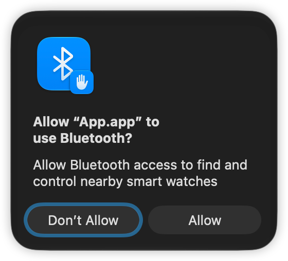
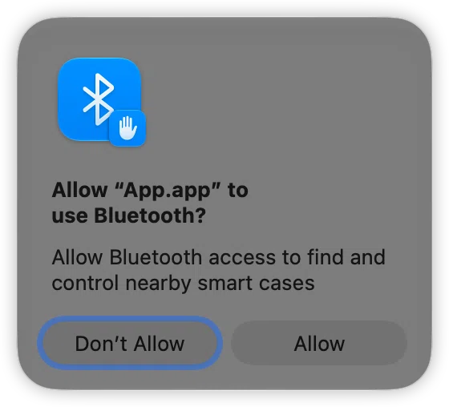

# Bug 4：蓝牙授权弹窗文案误写 smart watches 排查记录

> 4. When `app` starts the first time, the Bluetooth permission popup says "Allow Bluetooth access to find and control nearby smart watches". This is wrong, the popup should say "Allow Bluetooth access to find and control nearby smart cases".

*本文件为中文版；English version: [bug-04-SOP.md.en.md](bug-04-SOP.md.en.md)*

## 1. 固定版本与现场

- 基线分支 / 提交号：main @ ad266971（Initial commit；修复分支自同一提交切出）
- 未提交改动及保存方式：修复已提交 `2ad9eb9`（`app/App.xcodeproj/project.pbxproj` Debug / Release 两处 UsageDescription：watches→cases，仅此一个文件）；本记录与 `bug-analysis-images/` 下三张截图另走一条 `docs:` 提交
- 修复分支：`fix/04-bluetooth-usage-description`
- 环境：Mac（MacBookAir10,1 / Apple M1，macOS 27.0.1）；iPhone 不适用（本 Bug 仅涉 Mac 端）；Xcode 27.1 (27A9275)
- 蓝牙权限 / 初始按钮数据：蓝牙权限即本 Bug 主体——macOS TCC 按 bundle id（com.bragi.App）缓存授权决定，弹窗仅在无缓存记录时出现；初始按钮数据不适用

> 不用 reset/clean 固定版本；排查期间不升级依赖和系统。

## 2. 现象与复现

- 预期 / 依据：README Bug 4——弹窗应显示 “Allow Bluetooth access to find and control nearby smart cases”；实际：显示 “…nearby smart watches”
- 最近一次正常的时间 / 版本 / 配置：无（基线上首次可见的弹窗即错，非回归）
- 初步分类：疑似缺陷（权限说明文案与产品不符）

| 步骤 | 操作 | 预期 | 实际 |
| --- | --- | --- | --- |
| 1 | 系统蓝牙授权记录中无 com.bragi.App 时（首次运行，或先在 系统设置 > 隐私与安全性 > 蓝牙 移除 App），编译并运行 App scheme（Mac 端 app） | 授权弹窗说明文字为 smart cases | 弹窗显示 smart watches（下图，2026-10-30） |

- 复现次数 / 最小复现：复现日期 2026-10-30。最小复现＝TCC 无 com.bragi.App 记录时运行 App；完整「修复 → 验证」循环实际跑通两三次（中间有反复：漏做“移除授权”时弹窗不出现，见 3.3）
- 如需日志：未采集（纯文案问题，无需日志）

## 3. 分层排查（从易到难，做到定位即止）

每层填四格；结论选：发现异常 / 未见异常 / 证据不足 / 不适用。
思路：沿“上层送出的值 → 下层收到的值”找最早出差异的边界。

### 3.1 App 代码层（Mac `app` 与 iPhone `smartcase` 都看）

| 查什么 / 在哪查 | 预期 | 实际 | 结论 |
| --- | --- | --- | --- |
| 全盘搜索 `smart watches`（`grep -rn "smart watches" --exclude-dir=.build --exclude-dir=.git .`） | 定位文案唯一真源 | 命中 `app/App.xcodeproj/project.pbxproj` 两处（Debug / Release 的 `INFOPLIST_KEY_NSBluetoothAlwaysUsageDescription`）与 README 题面引用；Swift 源码与 `app/App/Info.plist`（空 `<dict/>`）均无该串 | 发现异常 |

### 3.2 SDK 层（SmartCaseKit：编码、解码、状态）

不适用（SmartCaseKit 不含该文案，未改动）。

（需要时补 BLE 数据：消息 ID / Action / 原始字节十六进制。）

### 3.3 iOS / macOS 系统层（权限、蓝牙开关、前后台、回调）

| 改变的条件（一次一个） | 操作前 | 操作后 | 结论 |
| --- | --- | --- | --- |
| 系统设置 > 隐私与安全性 > 蓝牙：移除 App（清 TCC 授权缓存；等价 `tccutil reset Bluetooth com.bragi.App`） | 已改文案并 Clean Build Folder 重新编译，运行后弹窗不出现 | 再次运行，授权弹窗重新出现并显示当前文案 | 发现异常——弹窗是否出现由 TCC 缓存决定，与产物是否重建无关；这是验证新文案的必要前置步骤 |

### 3.4 硬件层（距离 / 干扰 / 换设备对照）

不适用。

> 没有对照设备就写“未验证”；不凭排除法判硬件故障。

## 4. 根因与修复

- 触发条件 / 首次出错位置（端、文件、函数）：Mac 端 `app`；`app/App.xcodeproj/project.pbxproj` 构建设置 `INFOPLIST_KEY_NSBluetoothAlwaysUsageDescription`（基线 Debug 399 行 / Release 429 行）
- 出错机制 → 如何导致现象：App 初始化创建 `CBCentralManager`（`smartcasekit/Sources/SmartCaseKit/SmartCaseDeviceManager.swift:17`）时，macOS 首次申请蓝牙权限，弹窗文字取自打包产物 Info.plist 的 `NSBluetoothAlwaysUsageDescription`；该键由上述构建设置注入（`GENERATE_INFOPLIST_FILE = YES`，`App/Info.plist` 为空 `<dict/>`），注入值误把产品描述为 smart watches → 弹窗误导用户
- 证据（截图 / 日志 / 断点值）：

  产物核验：`plutil -p ~/Library/Developer/Xcode/DerivedData/Assignment-*/Build/Products/Debug/App.app/Contents/Info.plist | grep -i bluetooth`（修复前 watches → 修复后 cases，2026-10-30 复核）

- 最小修复 / 为什么改这里而不是另一端：两处构建设置（Debug、Release）watches→cases，缺一则对应配置的构建产物仍是旧文案。该文案唯一真源是 App target 的构建设置；iPhone 端 smartcase 的描述（“Allow Bluetooth so app can simulate a smart case”）本就正确，不动；也不把该键写进 `App/Info.plist`，避免出现双真源
- 验证前置（非常重要）：macOS 按 bundle id 缓存蓝牙授权决定，Clean Build Folder / 删除产物不影响缓存。必须先在 系统设置 > 隐私与安全性 > 蓝牙 移除 App（或 `tccutil reset Bluetooth com.bragi.App`），再运行，弹窗才会重新出现
- 如何撤销本次修改：`git revert` 修复提交 `2ad9eb9`；或 `git checkout ad266971 -- app/App.xcodeproj/project.pbxproj` 取回基线版本（把两处值改回 watches）后重新提交。注意：修复已入库，光 `git checkout -- <file>` 只会恢复出带修复的 HEAD，撤不掉任何东西

## 5. 验证与交付

| 项目 | 通过标准 | 修复后结果 |
| --- | --- | --- |
| 原复现步骤 | 授权弹窗显示 “…nearby smart cases” | 通过（下图；2026-10-30 产物 plist 复核同为 cases） |
| 单测（`smartcasekit` 内 `swift test`，按需） | 不适用（纯配置文案，无行为代码变更） | 未做 |
| 双端真机回归（按需） | 不适用（仅 Mac 端文案变更，iPhone 端未触碰） | 未做 |

- [x] 单测通过 ≠ 双端 BLE 已验证；本次两项均“不适用 / 未做”（纯配置文案，无 BLE 行为变更）
- [ ] 已向报告人/QA 同步结论与适用条件；未复测的保持“待确认”并约定跟进。（未做）
- [x] 独立分支交付（见 [README 交付要求](README.md#how-to-deliver-the-solutions)），不合并进 main；提交说明写清改了什么、为什么。（已按此执行：修复 `2ad9eb9` 与本记录分两条提交在 `fix/04-bluetooth-usage-description`）
